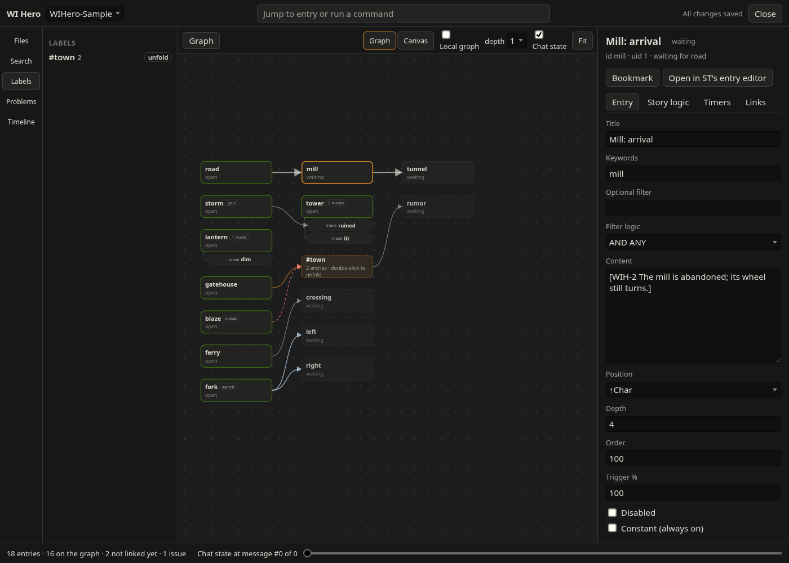
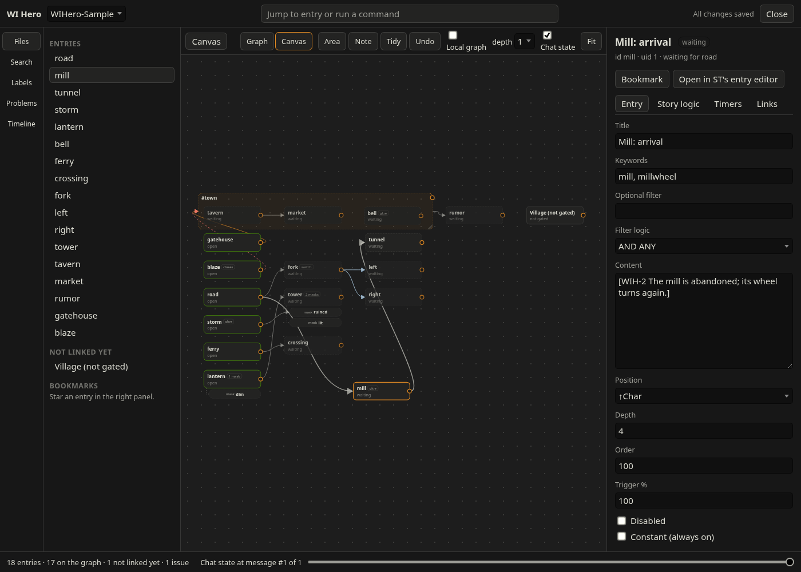
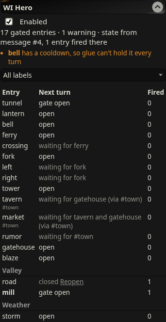
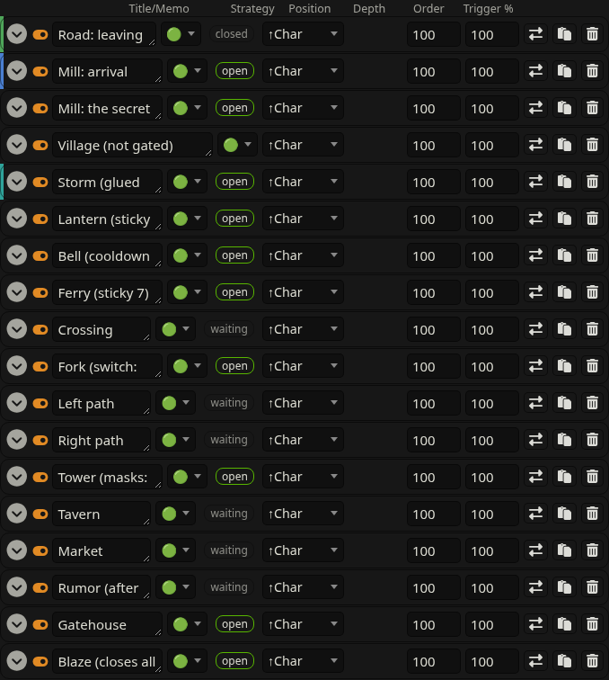

# WI Hero

A SillyTavern extension for story-gated World Info: entries that only become eligible once the story reaches a point, and retire once it moves past.

Status: M1–M10 (gates, chains, glue, the entry editor, railway switches, masks, labels, folders and visuals). The node editor is for later. Targets SillyTavern 1.19.0.

- [Design](docs/DESIGN.md)
- [Roadmap](docs/ROADMAP.md)
- [Technical notes](docs/TECHNICAL_NOTES.md): how the design maps onto ST's World Info hooks

## Gating an entry

Open an entry in the World Info editor. At the bottom of its edit area there's a **WI Hero** section:


- **Id**: suggested from the entry's title (click the suggestion to use it).
- **Gates**: the ids this entry waits for. Click an id below the field to add it. **Needs** picks all of them or any.
- **Close its gates when this fires** and **Glue**, with glue's close conditions.
- **Switch** paths, and **Masks** (name, the gates that make it active, its content).
- Problems (red) and warnings show as you type. **Save** writes the config to the book, and **Remove** takes it off so the entry is vanilla again.
- Saving changes the entry, so its own sticky and cooldown timers reset, as with any edit.

The editor stores a `wihero` field on the entry in the lorebook JSON (`data/default-user/worlds/<book>.json`), which you can also write by hand:

```json
"wihero": { "id": "mill", "gates": ["road"], "gateMode": "all", "closeGates": true }
```

- `id`: stable name other entries refer to. Letters, digits, `_ . : -`.
- `gates`: ids that must have fired before this entry may fire. Leave out for an entry that's open from the start.
- `gateMode`: `"all"` (default) or `"any"`.
- `closeGates`: when this entry fires, the gates it opened from close for good (a chain advancing). Default `true`.
- `labels`: names (`["town"]`). `#town` in any gate or close list means "any entry with this label has fired".
- `gatesFor`, `closes`: ids or `#labels` this entry acts on. `gatesFor` makes every target also wait for this entry (on top of its own gates); `closes` retires every target when this entry fires. The panel shows labels on each row and can filter by label.
- `switch`: ids of two or more paths (on the fork entry). When one fires, the others close for this branch of the story. If two fire in the same turn, only the first listed is injected.
- `masks`: `[{ name, content, gates?, gateMode? }]`, alternate content for the entry. A mask is active once its gates have fired (the last such mask wins), or when selected with `/wihero-mask entry=<id> <name>`; `/wihero-mask entry=<id>` clears the selection. A mask without gates is only active when selected. The selection is part of the chat state, so deleting or swiping back undoes it. The panel shows the active mask.
- `glue`: `true`, or `{ closeKeywords, closeWhenFired, closeWhenAllFired }`. Keeps the entry injected every turn from its first firing until a condition is met, then closes it. Close keywords are checked against the turn's new messages (the user message(s) and the reply). A glued chain link isn't closed when the chain advances.

A gate opens on the turn after its parent fires. Entries with a config problem never fire; the panel lists the problem. A closed entry has a **Reopen** button in the panel, for when the story changed in a way WI Hero can't see (an edited message, say). It applies from the current message on and rewinds like everything else.

ST's own timers still win. A running sticky finishes even after its entry closes (the panel shows `sticky (closed)`), and cooldown and delay can hold back a glued entry (the panel warns about glue with a cooldown). Sticky and cooldown count messages, two per turn, so N lasts floor((N-1)/2) more turns.

## The workspace

**Open workspace** in the WI Hero panel (or **Workspace** next to ST's World Info search) opens a full-screen view of a book: the whole story as a graph, laid out by its gates, with each entry's status in the open chat.



- Links: gates, switches, label gates and `gatesFor`, `closes`, glue endings, mask gates into the mask pills under their entry. A `#label` is a hub card its entries point to.
- Click an entry for its summary, links and history on the right; hover for its content; double-click to open it in a tab.
- **Local graph** shows only what's within 1 or 2 links of the selected entry. Labels and folders fold into one card (Labels and Files in the sidebar).
- The slider at the bottom shows the chat state at any earlier message; the Timeline lists what fired when.
- The right panel edits the selected entry: **Entry** (title, keywords, filter, content, position, depth, order, trigger %, and more), **Story logic** (everything the WI Hero section edits), **Timers** (sticky, cooldown, delay), **Links** (links both ways, its history in this chat, and **unlinked mentions**: entries whose text mentions its keywords, with one click to gate them on it). Saves go through ST, like any edit.

### Canvas

Switch the workspace from **Graph** to **Canvas** to arrange the book yourself, the way you'd lay out a story on a board.



- Drag cards anywhere. Places are kept per book in the extension settings, never on the entries, so arranging never resets ST's timers. New cards appear where the graph would put them; **Tidy** lays everything out again; **Undo** (Ctrl Z) steps back.
- A label is a box around its entries: resize it by its corner, and drop a card into or out of it to add or remove the label (it asks first, since that edits the entry).
- **Area** adds a named frame to arrange cards in, **Note** a note card. Both are for you only: nothing in them reaches the model.
- Draw a link by dragging the dot on a card's right edge onto another card, a label box or a mask pill. A menu asks what the link means: gate, closes, ends glue, gates for a label, mask gate, or another switch path from a fork. A link that would break something (a loop, say) is refused with the reason.

## The panel and the entry list

Extensions → WI Hero lists every gated entry with its status for the next turn, how often it fired in this chat, and its labels, grouped by folder. Entries that fired last turn are bold. In ST's World Info editor each entry row shows a WI Hero badge with the same status (hover for the reason) and a stripe in the entry's color.

 

The panel at a phone's width: [docs/img/panel-narrow.png](docs/img/panel-narrow.png).

## Folders and bulk edits

Give entries a **Folder** (`Town/Inn`) and a **Color** in the WI Hero section. Above ST's entry list, next to the search box, a folder menu shows only that folder (subfolders included), and a bar of bulk actions appears for it: enable, disable, trigger %, depth, order offset, keyword prefix, color. Each asks before applying. Folders and colors never change what fires.

## Trying it

1. Copy `examples/WIHero-Sample.json` to `SillyTavern/data/default-user/worlds/` and select it as a global lorebook.
2. Open Extensions → WI Hero. It lists `road` (open), `mill` and `tunnel` (waiting).
3. Chat: mention the **road**, then the **mill**, then the **mill** again. Watch `[WIH-…]` lines in the prompt (Prompt Inspector) and the panel:
   - turn 1: WIH-1 fires; `mill` opens.
   - turn 2: WIH-2 fires; `road` closes, `tunnel` opens.
   - turn 3: WIH-2 and WIH-3 fire; `mill` closes.
4. Swipe or delete the last reply: the panel goes back one step.

## Tests

`npm test` runs the engine tests (no SillyTavern needed).
