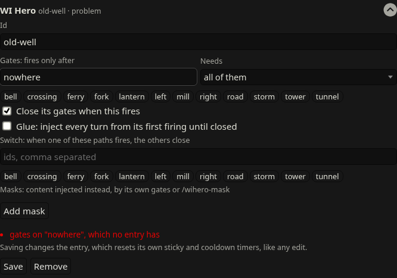

# WI Hero

A SillyTavern extension for story-gated World Info: entries that only become eligible once the story reaches a point, and retire once it moves past.

Status: M1–M7 (gates, chains, glue, the entry editor, railway switches and masks). Targets SillyTavern 1.19.0.

- [Design](docs/DESIGN.md)
- [Roadmap](docs/ROADMAP.md)
- [Technical notes](docs/TECHNICAL_NOTES.md): how the design maps onto ST's World Info hooks

## Gating an entry

Open an entry in the World Info editor. At the bottom of its edit area there's a **WI Hero** section:



- **Id**: suggested from the entry's title (click the suggestion to use it).
- **Gates**: the ids this entry waits for. Click an id below the field to add it. **Needs** picks all of them or any.
- **Close its gates when this fires** and **Glue**, with glue's close conditions.
- **Switch** paths, and **Masks** (name, the gates that make it active, its content).
- Problems (red) and warnings show as you type. **Save** writes the config to the book, and **Remove** takes it off so the entry is vanilla again.
- Saving changes the entry, so its own sticky and cooldown timers reset, as with any edit.

The editor stores a `wihero` field on the entry in the lorebook JSON (`data/default-user/worlds/<book>.json`), which you can also write by hand:

```json
"wihero": { "id": "mill", "gates": ["road"], "gateMode": "all", "closeGates": true }
```

- `id`: stable name other entries refer to. Letters, digits, `_ . : -`.
- `gates`: ids that must have fired before this entry may fire. Leave out for an entry that's open from the start.
- `gateMode`: `"all"` (default) or `"any"`.
- `closeGates`: when this entry fires, the gates it opened from close for good (a chain advancing). Default `true`.
- `switch`: ids of two or more paths (on the fork entry). When one fires, the others close for this branch of the story. If two fire in the same turn, only the first listed is injected.
- `masks`: `[{ name, content, gates?, gateMode? }]`, alternate content for the entry. A mask is active once its gates have fired (the last such mask wins), or when selected with `/wihero-mask entry=<id> <name>`; `/wihero-mask entry=<id>` clears the selection. A mask without gates is only active when selected. The selection is part of the chat state, so deleting or swiping back undoes it. The panel shows the active mask.
- `glue`: `true`, or `{ closeKeywords, closeWhenFired, closeWhenAllFired }`. Keeps the entry injected every turn from its first firing until a condition is met, then closes it. Close keywords are checked against the turn's new messages (the user message(s) and the reply). A glued chain link isn't closed when the chain advances.

A gate opens on the turn after its parent fires. Entries with a config problem never fire; the panel lists the problem. A closed entry has a **Reopen** button in the panel, for when the story changed in a way WI Hero can't see (an edited message, say). It applies from the current message on and rewinds like everything else.

ST's own timers still win. A running sticky finishes even after its entry closes (the panel shows `sticky (closed)`), and cooldown and delay can hold back a glued entry (the panel warns about glue with a cooldown). Sticky and cooldown count messages, two per turn, so N lasts floor((N-1)/2) more turns.

## Trying it

1. Copy `examples/WIHero-Sample.json` to `SillyTavern/data/default-user/worlds/` and select it as a global lorebook.
2. Open Extensions → WI Hero. It lists `road` (open), `mill` and `tunnel` (waiting).
3. Chat: mention the **road**, then the **mill**, then the **mill** again. Watch `[WIH-…]` lines in the prompt (Prompt Inspector) and the panel:
   - turn 1: WIH-1 fires; `mill` opens.
   - turn 2: WIH-2 fires; `road` closes, `tunnel` opens.
   - turn 3: WIH-2 and WIH-3 fire; `mill` closes.
4. Swipe or delete the last reply: the panel goes back one step.

## Tests

`npm test` runs the engine tests (no SillyTavern needed).
